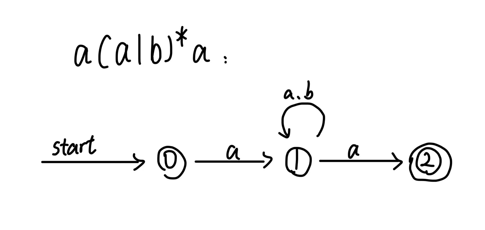
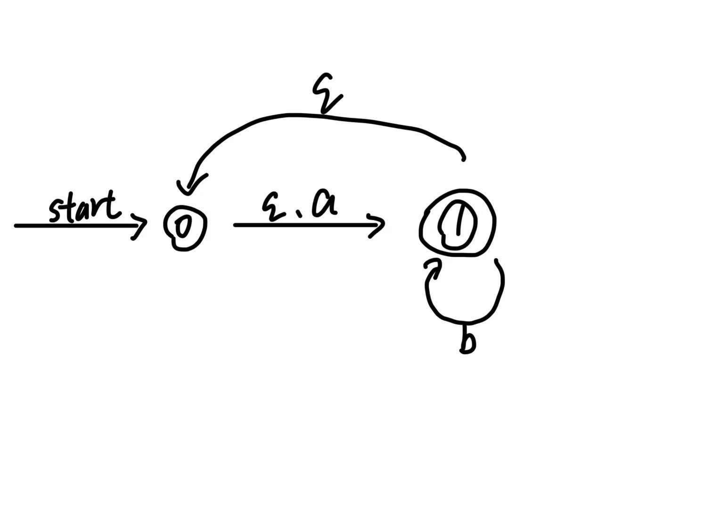
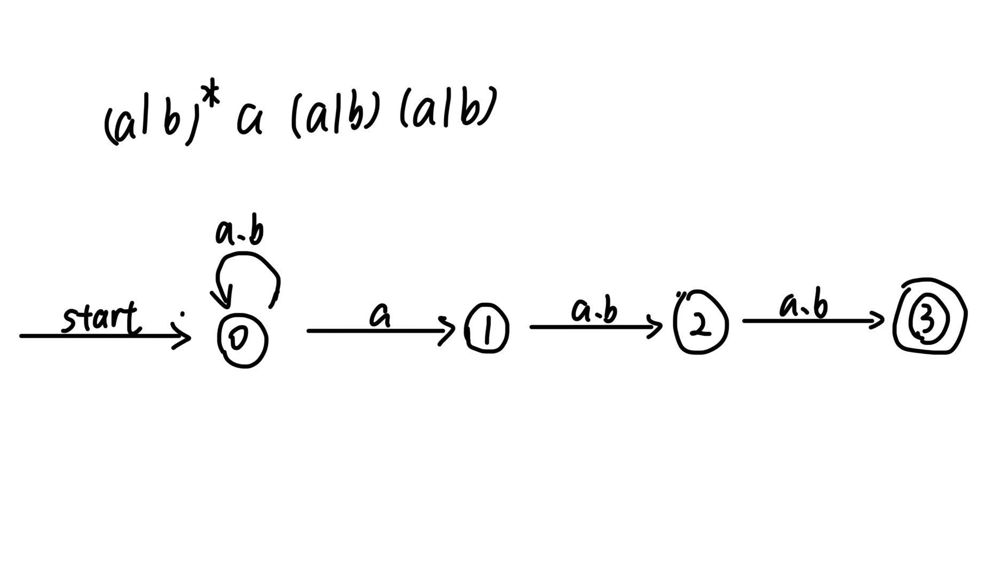
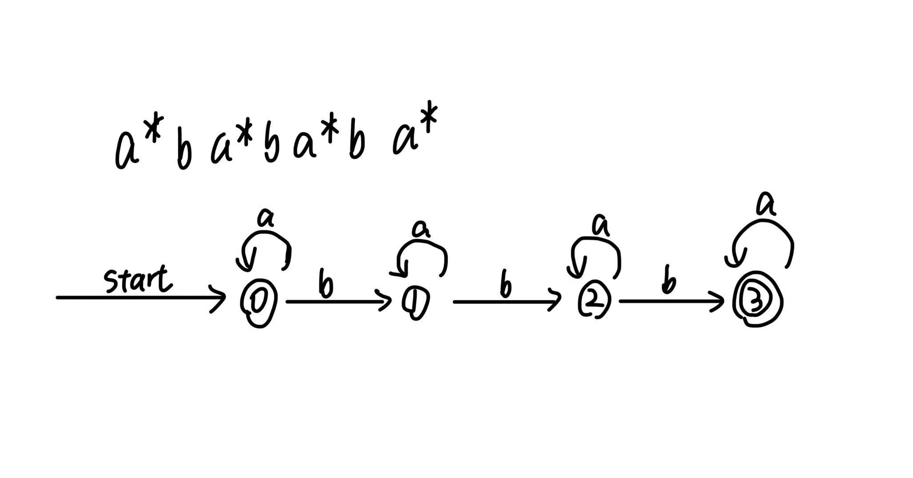
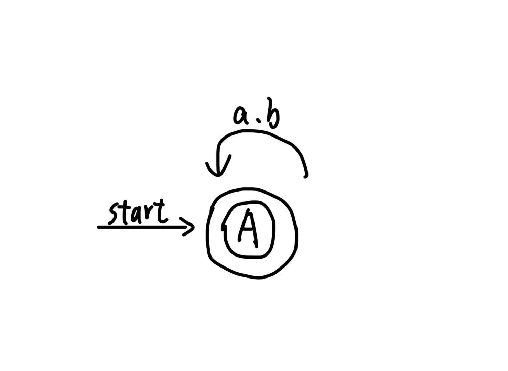

# 241880334 闵振昌 作业一
## 问题1
这个正则表达式定义的是在字母表$\{a,b\}$上，所有长度至少为 3，且倒数第三个字符为 a 的由 $\{a,b\}$ 构成的字符串。

## 问题2
由于不允许有子序列aba，那么任意两个a之间要么没有b，要么有2个及以上个b

所以可以得出一个符合条件的正则表达式

$b^*(\epsilon|aa^*(bbb^*aa^*)^*)b^*$

## 问题3

## 问题4
路径1：$0 \xrightarrow{a} 1 \xrightarrow{a} 2 \xrightarrow{b} 2 \xrightarrow{b} 3$

路径2：$0 \xrightarrow{a} 0 \xrightarrow{a} 1 \xrightarrow{b} 1 \xrightarrow{b} 1$

对于路径2，也读完了aabb，但是没有到达接受状态

由于存在路径1可以到达接受状态，所以这个NFA是接受aabb的

## 问题5
| 状态 | $a$ | $b$ | $\epsilon$ |
| ---- | ---- | ---- | ---- |
| 0    | $\{1\}$ | $\varnothing$ | $\{3\}$ |
| 1    | $\varnothing$ | $\{2\}$ | $\{0\}$ |
| 2    | $\varnothing$ | $\{3\}$ | $\{1\}$ |
| 3    | $\{0\}$ | $\varnothing$ | $\{2\}$ |

## 问题6
求初态0的ε-闭包。

从0: $0 \xrightarrow{\epsilon} 3$

从3: $3 \xrightarrow{\epsilon} 2$

从2: $2 \xrightarrow{\epsilon} 1$

从1: $1 \xrightarrow{\epsilon} 0$

所以: $\epsilon\text{-closure}(0) = \{0, 1, 2, 3\}$

所以 $A=\{0, 1, 2, 3\}$ 是DFA的初态
