# 第四章 语法分析
## 引言
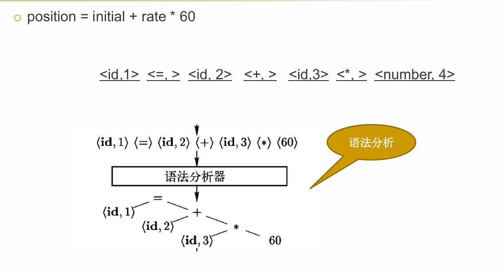
文法（Grammar）就是一套规则，用来规定程序代码应该怎么写，才算符合一门编程语言的语法
基于文法可以构造语法分析器
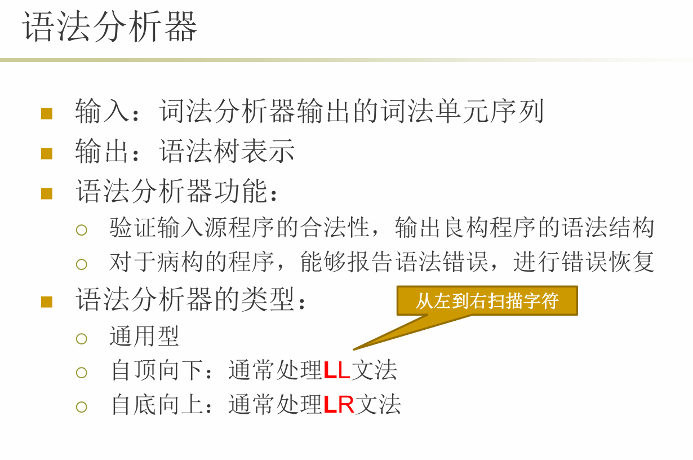
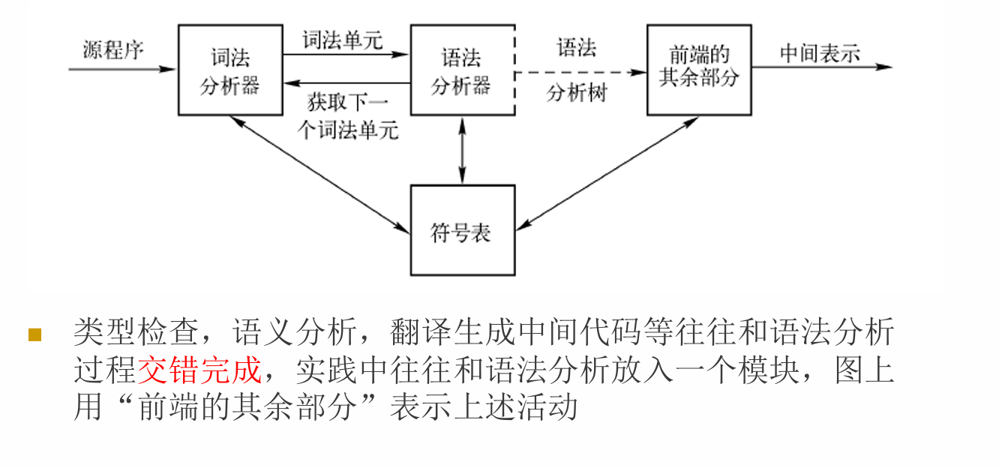
LL和LR是两种语法分析方法，需要文法规则符合某种规则
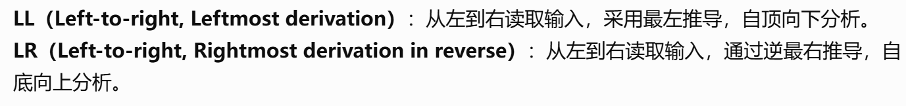
E是expression表达式，T是term项，假设我们专指term是乘法项，所以term可以通过加法形成新的E，T本身也是E
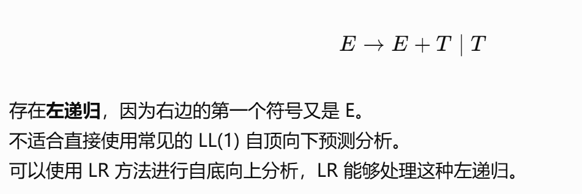
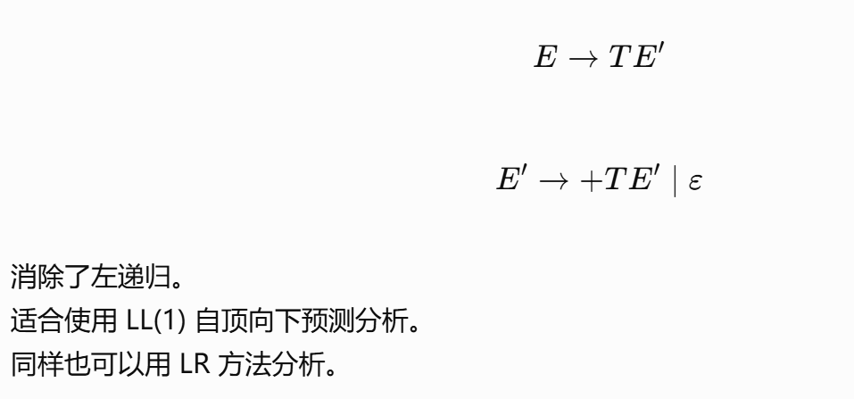
文法决定哪些表达式合法，LL 和 LR 决定语法分析器如何识别这些表达式

## 上下文无关文法(Context Free Grammar)
文法实际上就是替换，上下文无关就是说不论 stmt 出现在程序的什么位置，只要还没遇到终结符，都可以按照这条规则进行替换。
它的替换规则不依赖于前面或者后面出现了什么符号。
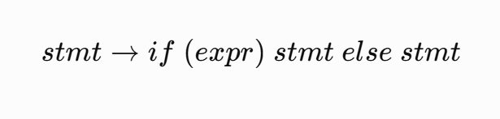
比如说这个文法，stmt就是statement语句
意思就是说一个语句可以是一个if-else语句
```c
if (x > 0)
    y = 1;
else
    y = 2;
```
比如这样的语句就是符合这个文法规则的，其中`y=1;`和`y=2;`也都是语句

### CFG由什么组成
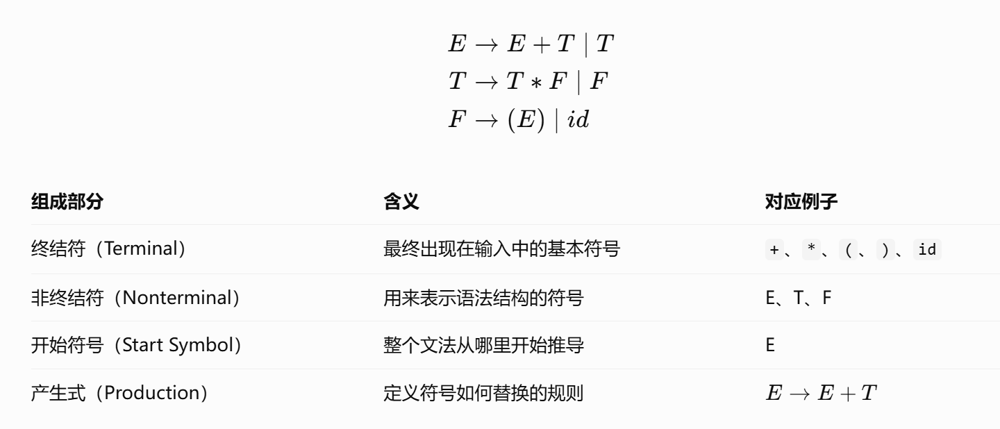
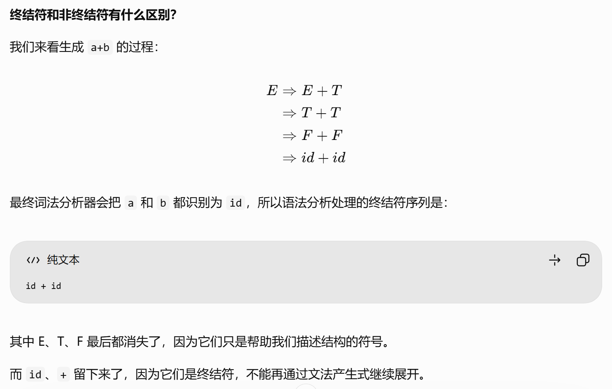
这里id就是表示一个变量的意思
加上减法除法，我们就可以得到所有算术表达式的文法
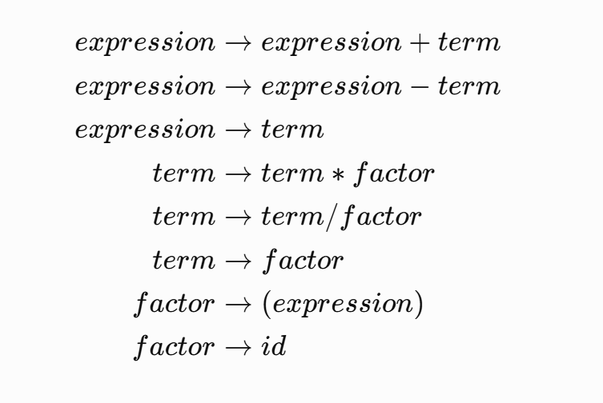
为什么F也可以是括号E呢？加括号表示优先运算，这样E也可以参与乘除法

### 推导
产生式又可称为重写规则，所谓推导就是将待处理的串中的某个非终结符号替换为这个非终结符号的某个产生式
从开始符号出发，不断进行上面的替换，就可以得到文法的不同句型
每使用一次产生式替换一个非终结符，就叫做一步推导
比如文法是 E →-E | E+E | E*E | (E) | id
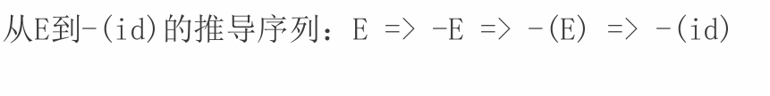
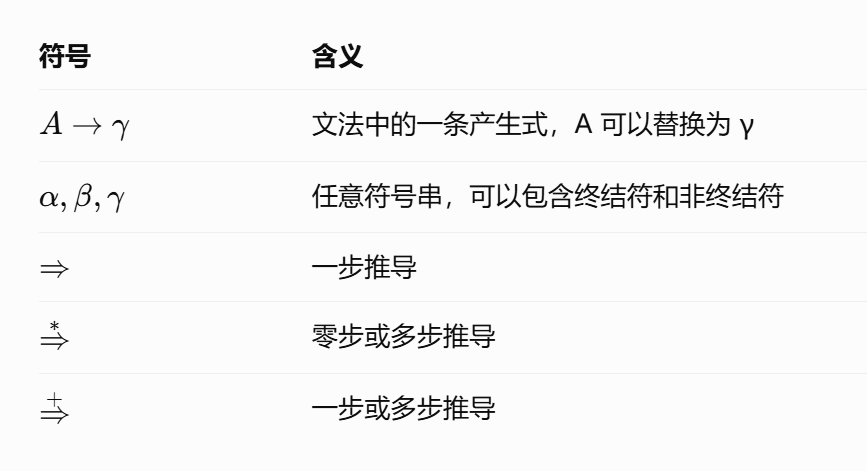
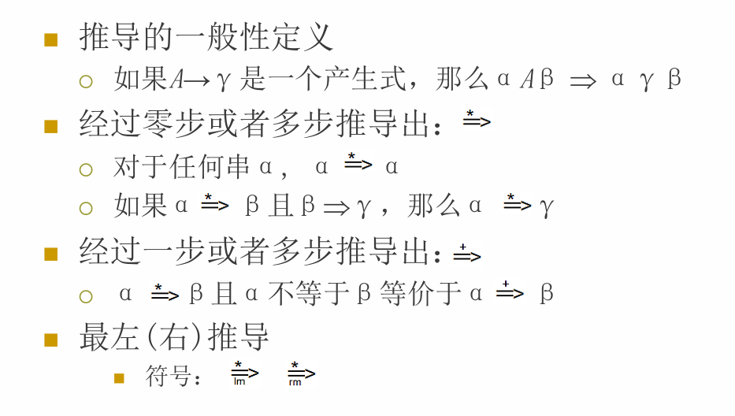
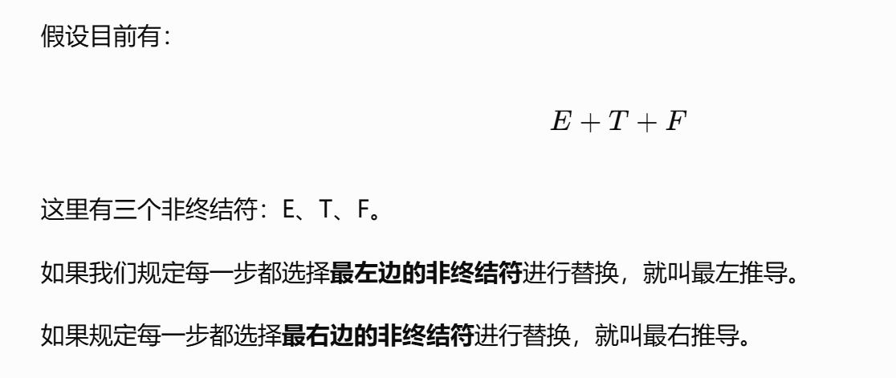
LL 分析使用最左推导，自顶向下构建语法结构。
LR 分析使用最右推导的逆过程，自底向上进行归约。
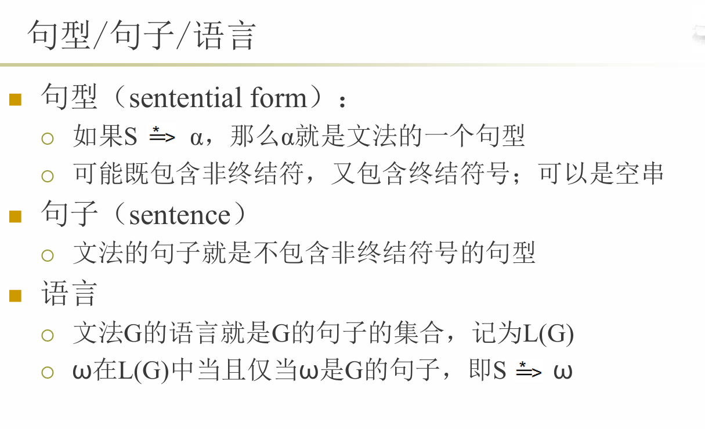

### 推导的问题
从推导的角度来看，语法分析的任务就是接受一个终结符号串作为输入，找出从开始符号推导到这个串的一个方法，如果找得到那么就说明是合法的
